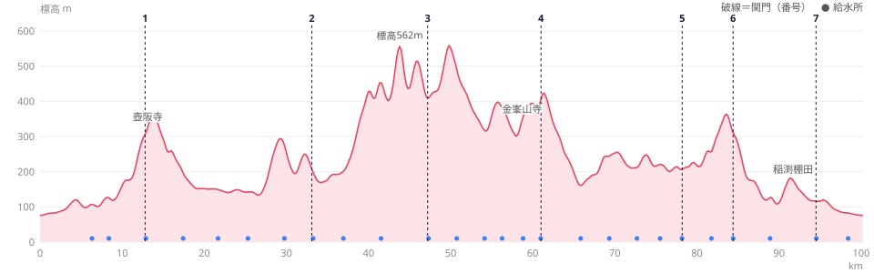
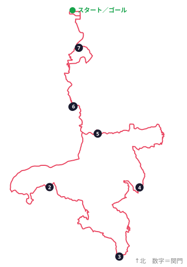

# 🏔 第2回 奈良ウルトラマラソン（2027年5月30日）

**あと 183 日**（2026-11-28 時点）　100.2km・累積標高 約1,875m・制限 約14時間40分・スタート 4:30〜5:00（WAVE別）・会場 藤原宮跡（橿原市）

> コースデータ・関門は **2026大会の公式参考値**（2027 は調整中）。GPX は大会公式のもので、自分の走行記録ではない。
> [公式サイト](https://www.r-wellness.com/nara/) / [コース情報・関門](https://www.r-wellness.com/nara/course/) / [スケジュール](https://www.r-wellness.com/nara/schedule/) / [コース（Googleマップ）](https://www.google.com/maps/d/u/0/embed?mid=1_bZ-LqHd0ItyplssV4kRgzSEpQac-zA&ehbc=2E312F&noprof=1) / [GPXデータ（公式）](https://www.r-wellness.com/nara/2026/wp-content/themes/nara/download/nara-100km.gpx)

## 📈 ロング走の進み具合

- 30km以上のロング走: 1本（ウルトラ本番までに40km以上を2本・50kmを1本が目安）
- 週間計画と実績・期間の考え方は、上の「📅 計画」にまとめてある（2026-11-25 に分離）

## 🎯 目標

| 区分 | タイム | 考え方 |
|------|--------|--------|
| 最低ライン | **完走（制限14時間40分前後）** | 初めての100km。累積標高約1,900m（GPXの生値では約2,000m）の山岳コースで、関門は7か所 |
| 目標 | **13時間00分** | フルの持ちタイム（3:59:46・奈良/京都でサブ4）からの目安は平坦で11時間20分前後。高低差を足して13時間とする |
| 上振れ | 12時間30分 | 奈良12/13・大阪2/28 の結果と、4〜5月のロング走の出来で判断 |

- 目標は **大阪マラソン（2/28）の結果が出た3月に見直す**。サブ3:45 が出れば12時間30分を目標に上げる
- 巡航の強度は **心拍140前後（HRmax 190 の74%）**。11/14 の奈良マラソンコース試走（10.27km・平均心拍138・止まらずに走った区間は 5:57/km）が近い強度。11/1 のロング走（上限160・平均157）より一段低い。平地で何分/kmになるかは3月の3時間走で実測して決める

## 🗺 コース

### 関門で区切った区間

| 区間 | 距離 | 登り | 下り | 最高標高 | 給水 | 閉鎖時刻 |
|------|-----:|-----:|-----:|-------:|----:|-------:|
| 0.0→12.8km（第1関門） | 12.8km | 268m | 37m | 307m | 2 | 6:50 |
| 12.8→33.1km（第2関門） | 20.3km | 288m | 388m | 364m | 5 | 9:40 |
| 33.1→47.2km（第3関門） | 14.1km | 540m | 338m | 555m | 3 | 11:50 |
| 47.2→61.0km（第4関門） | 13.8km | 350m | 354m | 558m | 6 | 13:55 |
| 61.0→78.2km（第5関門） | 17.2km | 170m | 369m | 424m | 5 | 16:20 |
| 78.2→84.4km（第6関門） | 6.2km | 173m | 68m | 363m | 2 | 17:15 |
| 84.4→94.5km（第7関門） | 10.1km | 81m | 276m | 307m | 3 | 18:40 |
| 94.5→100.2km（フィニッシュ） | 5.7km | 4m | 45m | 119m | 2 | 19:10〜19:30 |

### 主な登り（獲得100m以上）

| 区間 | 獲得 | 標高 | 平均勾配 |
|------|-----:|-----|-------:|
| 0.0→13.8km | 288m | 76→364m | 2.1% |
| 19.2→29.3km | 143m | 151→294m | 1.4% |
| 34.2→41.5km | 284m | 169→454m | 3.9% |
| 42.4→43.8km | 153m | 402→555m | 11.0% |
| 47.2→49.8km | 149m | 409→558m | 5.7% |
| 58.0→61.3km | 123m | 301→424m | 3.7% |
| 74.9→83.6km | 148m | 215→363m | 1.7% |

- **12.8km の第1関門（2時間20分以内・壺阪寺の手前）は焦らない**。0〜9km はほぼ平坦で、そこから壺阪寺まで約250mの登り。ここで心拍を上げると後半に響く
- **平らに見える区間にも小さな上り下りが続く**（第1回の走行動画より）。足首とふくらはぎが少しずつ削られるので、序盤から上りで頑張らない
- **40〜50km が最大の山場**。36km から 44km にかけて約370m登って標高560m、いったん下ってもう一度 560m まで登り返す（第3関門 47.2km はこの谷間）。**勾配の強い登りは最初から歩く**と決めておく
  - 特にきつい坂（GPXで300mごとに見た勾配）: **42.7〜43.4km は最大18%前後**、48.7〜49.3km は12%前後、38km・45km にも10%台がある。第1回の動画では、速いランナーでもこの区間の心拍が180台まで上がっていた。心拍140前後で巡航する計画なので、ここは歩く前提で考える
- **58km 付近に金峯山寺の石段**（約400m区間）。走らずに歩いて脚を温存する
- **61km 以降は下りが続く**（61→66km で約270m 下る）。登りで脚を使い切ると、ここで太ももの前が動かなくなる。細かいピッチで着地の衝撃を小さく
- **80〜84km に最後の大きな登り（約160m）**。その後 90km まで下る
- **90〜91.5km の稲渕の棚田で、もう一度約70m登る**。終盤に残っている登りなので、「84kmで登りは終わり」と思い込まない
- **70km 過ぎに気持ちが落ちる**（第1回の動画では、金峯山寺の盛り上がりが終わったあたりで痛みと飽きがまとめて出ていた）。前もって「70〜80kmは落ち込むもの」と決めておき、次のエイドまでの距離だけを考える
- 給水所は約4〜5kmごと（2026年は26か所）。**紙コップがない大会なのでマイカップ・マイボトル必携**

コースの形（上が北）

## ⏱ ペース計画

目標 **13:00** を、登り1m＝平地8m の換算距離と後半の失速（序盤×0.92→終盤×1.12）で区間に配分した。給水所では1か所1分止まる計算。余裕は **最も遅いWAVE（5:00スタート）** で出している。

| 関門 | 距離 | 区間タイム | 区間ペース | 通過（経過） | 関門まで（経過） | 余裕 |
|------|-----:|---------:|---------:|----------:|-------------:|----:|
| 第1関門 | 12.8km | 1:31 | 7:08/km | 1:31 | 1:50 | **0:19** |
| 第2関門 | 33.1km | 2:25 | 7:09/km | 3:56 | 4:40 | **0:44** |
| 第3関門 | 47.2km | 2:01 | 8:35/km | 5:58 | 6:50 | **0:52** |
| 第4関門 | 61.0km | 1:55 | 8:22/km | 7:53 | 8:55 | **1:02** |
| 第5関門 | 78.2km | 2:11 | 7:37/km | 10:04 | 11:20 | **1:16** |
| 第6関門 | 84.4km | 0:55 | 8:49/km | 10:59 | 12:15 | **1:16** |
| 第7関門 | 94.5km | 1:19 | 7:48/km | 12:17 | 13:40 | **1:23** |
| フィニッシュ | 100.2km | 0:43 | 7:32/km | 13:00 | 14:30 | **1:30** |

- 余裕が最も小さいのは **第1関門（12.8km）の 0:19**。ここより前で貯金を作ろうとして前半を上げない
- 区間ペースは給水の停止込み。登りを歩く時間も含めた「平均」なので、平地では 6:30〜7:00/km が目安になる

## 🍙 補給の方針

- 1時間あたり **200〜250kcal** を目安に、エネルギージェル・おにぎり・羊羹などを練習で試してから本番に使う
- **試した補給食**: 2026-11-21 の22km走で、10km にスポーツようかん（あずき・40g・116kcal）、20km にオレは摂取すジェル エネルギー（グレープフルーツ風味・45g・112kcal）を1つずつ。問題なく走れた。**2本で計228kcal・約2時間10分なので1時間あたり約105kcal**で、ウルトラの目安（200〜250kcal/時）の半分。ウルトラでは同じ間隔なら1回に2本分、または30〜40分ごとに1本が必要になる。レースでもエイドの給食を積極的に食べてきて、**走りながら食べても便意は来ない**（本人の実感）。ウルトラでは固形物を胃が受けつけるかを、30km以上で確かめていく
- **30km走で試した補給（2026-11-28）**: 出発前にアミノバイタル トリプルショット、10kmごとにアミノバイタル パーフェクトエネルギー → オレは摂取すジェル エネルギー（はちみつレモン風味・109kcal・食塩0.8g）→ 飲めるようかん ANDO_（100kcal）の順。後半も失速せず（心拍ドリフト −1bpm）、走った後の疲労もかなり少なかった。ただし走りながら摂った分は約3時間で3本なので、カロリーが分かっている2本（209kcal）にパーフェクトエネルギーを足しても、ウルトラの目安（200〜250kcal/時）には届かない見込み（パーフェクトエネルギーのカロリーは未確認）
- 今の15km走の補給（アクエリアス ハンディパック＋アミノバイタル）は、ウルトラでは量が足りない。**30km以上のロング走で固形物を食べる練習をする**
- **エイドの食べ物が多い**（第1回は果物・アイス・私設エイドのハンバーガーなど）。ただし第2回も同じとは限らないので、**自分で持つ補給食だけで足りる量を基本**にして、エイドの食べ物はおまけと考える
- **暑さ対策**: 5月末でも昼前から気温が上がる（第1回の動画では、後半は水をかぶりながら走っていた）。エイドの氷水・冷水で首と頭を冷やす。キャップ・サングラスを用意し、5月の50km走を日が高くなる時間まで続けて試す
- 給水の時間を減らす方法として、1L 前後のハイドレーションパック（背負う水筒）も候補にする。マイカップ＋ソフトフラスクとどちらにするかは、4月の40km走で比べる
- 早朝ランでの便意の対策（朝食をビスケット1枚程度に減らす・11/6〜効果あり）は、ウルトラでは「スタート3時間前（1時半ごろ）に朝食、スタート直前に軽く」に置き換えて、4月の連続ロングで試す

## ✅ 準備

- [x] エントリー（2026年11月）
- [ ] 宿泊・駐車場の手配（会場は橿原市の藤原宮跡。スタート4:30〜5:00のため前夜の移動と駐車場を確認）
- [ ] 2027年大会のコース・関門時刻の確定版を確認（現在は2026年大会の参考値）
- [ ] ウルトラ用シューズを決める（MAGIC SPEED 5 で100km走るか、クッション重視の1足を足すか。4月の40km走までに決める）
- [ ] ポーチ・マイカップ・小型ライト（スタートは日の出前後。必要かは参加案内で確認）
- [ ] 擦れ対策（ワセリン・テーピング）を40km走で試す
- [ ] 足の爪の手入れ（直前に切りすぎない・つま先の余裕を確認。長い下りで爪が傷みやすい）
- [ ] 暑さ対策（キャップ・サングラス・首を冷やすもの）を5月の50km走で試す
- [ ] 補給食を決める（4月の連続ロングで試した結果から）
- [ ] 雨具を用意する（薄手で走りながら着脱できるもの。2026-11-28 の30km走は大雨で涼しく走りやすかったが、100kmで長時間濡れると体が冷える。春のロング走で一度着て試す）
- [ ] 家族と当日の応援・送迎の相談

### 見直し履歴

| 日付 | 内容 |
|------|------|
| 2026-11-28 | 補給の方針に30km走で試した補給を追記。準備チェックリストに雨具を追加（30km走が途中大雨で、本人が「奈良ウルトラは雨具が必要」と判断） |
| 2026-11-25 | 期間の考え方と週間計画を「📅 計画」（`plan/2026-27.md`）へ移し、このページは大会固有の内容だけにした |
| 2026-11-21 | 補給の方針に、22km走で試した補給食（ようかん・ジェル）と「走りながら食べても便意は来ない」という実感を追記 |
| 2026-11-18 | 第1回大会の走行動画（YouTube）の要点を反映。小さな上り下り・40〜50kmの急坂（GPXで勾配を確認）・90km過ぎの稲渕の登り・70km以降の気持ちの落ち込み・暑さ対策・エイド・爪の手入れ |
| 2026-11-15 | 初版。エントリー完了を受けて作成。奈良・京都・大阪・飛鳥の計画（2026-10-06）を前提に、3月中旬からウルトラ構築期を置いた |
